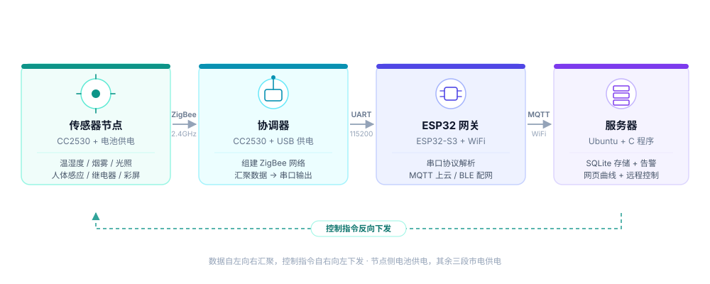

# ZigBee 无线环境监测系统

一个从裸机驱动一路写到 Linux 服务端的完整 IoT 项目，目标是把「传感器采集 → 无线组网 → 云端汇聚 → 数据落库 → 网页可视 + 远程控制」整条链路真正跑通，而不是停留在演示板点灯。

**在线开发手记：** https://qikai-lab.github.io/

---

## 系统架构



四层结构，每层职责单一、接口清晰：

| 层级 | 组成 | 职责 |
| --- | --- | --- |
| 感知层 | CC2530 + DHT11 / MQ-2 / 光敏 / 人体红外 | 定时采集环境数据，本地彩屏显示，电池供电 |
| 汇聚层 | CC2530 协调器 | 建立 ZigBee 网络、管理节点入网、串口输出 24 字节定长帧 |
| 网关层 | Ubuntu + C 服务端 | 串口解析、SQLite 落库、告警判定、内置 HTTP 服务与网页 |
| 上云层 | ESP32-S3 + ESP-IDF | 并联取协调器串口信号，解析后经 Wi-Fi 转 MQTT，摆脱 USB 与局域网限制 |

数据目前走**双链路并行**：协调器串口一路直连 Ubuntu（写 `env_data`），
另一路并联到 ESP32-S3 经 MQTT 上云（写 `env_data_mqtt`）。
两条链路互为**交叉验证**——同一时刻两边数值应当几乎相同，不一致就能立刻定位是哪一段坏了。

控制链路最终反向贯通：网页下发指令 → MQTT / 串口 → 协调器 → 节点 → 继电器动作。

---

## 当前进度

| 阶段 | 内容 | 状态 |
| --- | --- | --- |
| 第 0 周 | 工具链搭建与裸机冒烟（IAR + CC-Debugger + UART + GPIO） | ✅ |
| 第 1 步 | 节点读多路传感器，彩屏本地显示 | ✅ |
| 第 2 步 | 协调器 / 终端组网，**断网仍持续采样**，电池供电独立运行 | ✅ |
| 第 3 步 | Linux 网关：串口 → SQLite → HTTP → 网页 | ✅ |
| 附加模块 | 烟雾告警：中值滤波 + 自适应基线 + 状态机 | ✅ |
| 运维 | systemd 托管：开机自启 / 崩溃自动重启 / journald | ✅ |
| 第 4 步 | ESP32 网关接入，Wi-Fi + MQTT 上云 | 🟡 串口透传已验收，MQTT 待实测 |
| 第 5 步 | 远程控制继电器、低功耗与续航实测 | ⬜ |

已完成部分的关键数据：串口 115200 8-N-1 稳定收帧，**实测帧间隔 1.000 秒、坏帧 / 残帧 / 重同步 / 库错 / 断线重连全部为 0**；
网关为单进程单线程（epoll 统一事件循环），**178 项离线单元测试全部通过**，不需要任何硬件即可验证解析、落库、告警与 HTTP 响应。
服务化后实测 **`kill -9` 后 3 秒自动拉起**（PID 从 2350 变为 3343），`enabled` 开机自启；单次运行 68 帧时 `有效帧 = 入库 = 68`，无一帧掉队。

第 4 步阶段 A 实测：ESP32-S3 从协调器 UART 连续接收 **60 帧 / 1440 字节**，
每 5 秒统计精确 `+120 字节 / +5 帧`，**坏帧与无效字节全程为 0**。

---

## 技术栈

**嵌入式端**
`C` · `CC2530 (8051)` · `IAR EW8051` · `Z-Stack 2.5.1a` · `OSAL` · `ZigBee / IEEE 802.15.4` · `UART` · `ADC` · `单总线时序`

**网关固件**
`ESP32-S3` · `ESP-IDF v5.5` · `FreeRTOS` · `UART 透传` · `Wi-Fi 状态机与重连` · `MQTT (QoS 1 + 遗嘱消息)`

**服务端**
`Linux` · `C` · `termios` · `epoll` · `signalfd` · `单进程事件循环` · `SQLite (WAL + 批量事务)` · `socket 手写 HTTP` · `中值滤波与自适应基线` · `systemd`

**规划中**
`TLS` · `SNTP` · `反向命令通道`

---

## 目录

```
.
├── index.html              首页
├── posts/
│   ├── project-overview.html       项目全景：架构、功能、技术选型与取舍
│   ├── week0-bringup.html          第 0 周：工具链、里程碑与踩坑复盘
│   ├── week1-sensors.html          第 1 周：五路传感器打通与 ADC 三次翻车复盘
│   ├── week2-network.html          第 2 周：ZigBee 组网与「断网也要采样」的设计错误
│   ├── week3-linux-gateway.html    第 3 周：Linux 网关与「网页不能直接查库」的发现
│   ├── week4-smoke-alarm.html      第 4 周：烟雾告警与「永远不报警」的自锁陷阱
│   ├── week5-esp32-bridge.html     第 5 周：ESP32 上云与「COM 口在 ≠ 板子活着」
│   └── pinout-reference.html       终端节点板引脚速查表
├── code/
│   ├── linux_gateway/              Linux 网关源码（100% 自写，含 178 项离线测试）
│   └── esp32_bridge/               ESP32 网关固件（ESP-IDF v5.5）
└── assets/
    ├── css/style.css
    └── img/                架构图 / 引脚图 / 路线图 / 实物照片
```

---

## 源码

`code/linux_gateway/` 是项目第 3 步的完整实现——单进程单线程 C 服务，
termios 串口 + epoll 事件循环 + SQLite WAL 批量提交 + 手写 socket HTTP + 网页编进二进制。

`code/esp32_bridge/` 是第 4 步的网关固件——UART 收协调器帧、24 字节定长帧解析、
Wi-Fi 状态机、MQTT 发布（含遗嘱消息）。`tests/` 下有三个串口探针脚本，
用来区分「芯片没电 / 没进下载模式 / 波特率不对」这三种同样报 `No serial data received` 的故障。

```bash
cd code/linux_gateway
make && make test          # 178 项断言，不需要任何硬件
python3 tools/sim_node.py --socat   # 无硬件时用虚拟串口跑通全链路
```

点这里看说明：[`code/README.md`](code/README.md)

CC2530 那一层（终端节点 / 协调器）的工程骨架基于课程提供的 Z-Stack 示例，
整包公开涉及他人版权，所以没有放进仓库；那部分的关键实现与踩坑写在
第 1、2 周手记里。

---

## 关于这个仓库

代码与文档同步推进。每完成一个阶段，会把当阶段的源码、遇到的问题和解决过程一起整理进来——踩过的坑比顺利的部分更值得记录。
